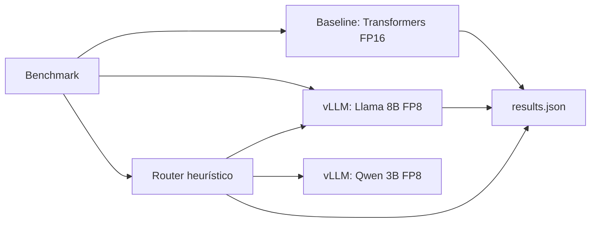

# Inference Cost & Reliability Pack

**Estado: implementación inicial; aún no hay resultados medidos.** Este repositorio no publica cifras de coste, latencia ni calidad hasta ejecutar el benchmark en el hardware descrito. El entorno de desarrollo actual no expone una GPU NVIDIA.

Responde una pregunta concreta: ¿qué cambia al servir una carga fija con Transformers/PyTorch FP16 frente a vLLM FP8, y qué coste de calidad y latencia añade derivar consultas sencillas a un modelo pequeño? El benchmark guarda las mediciones sin editar en [`results/results.json`](results/results.json) y genera las gráficas desde ese archivo.

## What's in this repo

- [`examples/domain_set.example.jsonl`](examples/domain_set.example.jsonl): tres filas deliberadamente ficticias para ilustrar el formato de intake.
- [`examples/domain_set.pii_invalid.jsonl`](examples/domain_set.pii_invalid.jsonl): dos fixtures inválidos; uno contiene un email de dominio reservado y otro un teléfono ficticio.
- [`examples/results.example.json`](examples/results.example.json): forma del informe, con métricas `null`/`pending`; no contiene resultados ni cifras.

Los ejemplos son solo formato. `__pycache__/` y `*.py[cod]` se omiten porque son artefactos generados, no archivos que necesiten fixture.

| Configuración | TTFT p95 | ITL p50 | tok/s @ c=32 | USD/1M tokens de salida | Accuracy (Δ vs. baseline) |
|---|---:|---:|---:|---:|---:|
| Llama 3.1 8B, FP16 naive | Pendiente | Pendiente | Pendiente | Pendiente | Pendiente; benchmark pendiente |
| Llama 3.1 8B, FP8 vLLM | Pendiente | Pendiente | Pendiente | Pendiente | Pendiente; benchmark pendiente |
| FP8 vLLM + router a Qwen 2.5 3B | Pendiente | Pendiente | Pendiente | Pendiente | Pendiente; benchmark pendiente |

La tabla se completa después de medir; no uses estimaciones de referencia como si fueran resultados de este sistema. Aún no se ha alquilado ni medido una H100. El coste requiere `GPU_HOURLY_USD` con la tarifa real y su fuente documentada. La exactitud publicada corresponde a la evaluación privada de prompts reales del cliente durante un contrato; sus casos y resultados no se incluyen en este repo.

## Problema e impacto

Un endpoint de generación puede gastar capacidad en solicitudes que no necesitan el modelo grande, y una comparación de latencia aislada no demuestra ahorro unitario ni calidad aceptable. Este estudio fija un modelo, un conjunto de prompts y una máquina para contrastar capacidad, latencia, coste derivado y exactitud.

La cifra útil para una decisión de negocio sale de la tasa de tokens medida y el coste horario configurado, no de un precio genérico por millón. No se presupone que FP8 gane en toda carga ni que el router mejore calidad o p95; ambas afirmaciones quedan sujetas a los resultados.

## Arquitectura



## Condiciones

- Modelos: `meta-llama/Meta-Llama-3.1-8B-Instruct` para baseline y FP8; `Qwen/Qwen2.5-3B-Instruct` para la ruta sencilla.
- El baseline usa `transformers` y `model.generate` en FP16, una petición por generación y sin batching continuo. FP8 lo aplica vLLM en tiempo de carga; se requiere hardware con soporte nativo FP8 (H100 o posterior recomendado para esta configuración).
- Una GPU NVIDIA con suficiente VRAM, Docker Compose con soporte GPU, acceso a los pesos de Llama y `HF_TOKEN` son requisitos. Los dos motores vLLM y el baseline comparten la GPU, por lo que la capacidad de memoria debe verificarse antes de ejecutar.
- El benchmark usa los 10 prompts de `eval/subset.jsonl`, concurrencias 1, 8, 32 y 64, y hasta 64 tokens de salida. Son parámetros configurables; compara ejecuciones con los mismos valores.
- La carga de rendimiento usa `eval/subset.jsonl`; la evaluación de calidad es separada y usa 200 preguntas de GSM8K test, extraídas con semilla fija desde el commit indicado en `eval/gsm8k_200.manifest.json`.
- TTFT es desde el envío HTTP hasta el primer fragmento de contenido; ITL p50 es el intervalo entre fragmentos recibidos. Throughput usa tokens de salida reportados por el servidor por tiempo total de la prueba. En el router, TTFT incluye su overhead.
- El runner intenta registrar nombre de GPU y VRAM pico vía NVML. En resultados, VRAM corresponde a toda la GPU compartida durante la prueba, no a memoria atribuida por proceso.
- El coste por millón de tokens de salida es coste horario GPU × 1.000.000 / (tokens/s agregados × 3.600). No incluye CPU, almacenamiento, red ni disponibilidad.
- GSM8K se puntúa por exact match de la respuesta final marcada `#### <número>`; no encontrar ese marcador cuenta como incorrecto.
- La evaluación privada del cliente sigue el contrato de [`INTAKE.md`](INTAKE.md) y la selección 60/25/15 de [`SELECTION.md`](SELECTION.md). La rúbrica es por `task_type` en [`eval/rubric_template.json`](eval/rubric_template.json); el archivo de trabajo es `private_eval/domain_set.jsonl` y no se versiona.
- El scoring de Capa B puede usar un juez compatible con OpenAI (`JUDGE_BASE_URL`, `JUDGE_MODEL`) y, si aplica, `JUDGE_API_KEY`. El juez usa la rúbrica versionada en `eval/judge_prompt.txt`, temperatura 0 y guarda modelo, hash de prompt y puntuaciones por caso en el informe privado. No se envían datos a un juez externo salvo que el cliente lo autorice; se recomienda endpoint local/autohospedado.

## Ejecutar

Requisitos: Linux con NVIDIA Container Toolkit, Docker Compose, GPU compatible con FP8 y acceso aceptado a los pesos de Llama.

```bash
export HF_TOKEN=...                 # token de Hugging Face con acceso a Llama
# Define GPU_HOURLY_USD con tarifa/proveedor reales. El intake privado va en private_eval/domain_set.jsonl.
# Configura JUDGE_* solo con autorización del cliente; es una capa opcional.
make eval-data
make up
make bench
make report
make down
```

`make eval-data` obtiene el split test del repositorio GSM8K fijado al commit del manifiesto. Antes de medir, valida el intake con `make validate-intake` (o `make validate-intake DOMAIN_DATASET=ruta/privada.jsonl`). `make bench` escribe `results/results.json`; `make report` crea las gráficas. Dataset e informe privados están excluidos de Git. GSM8K es un sanity check interno; la Capa B se omite si falta el archivo local o la configuración autorizada del juez.

## Resultados

No se han medido todavía. Tras `make bench`, consulta `results/results.json` local para host y pruebas por concurrencia. El informe puede contener scores y razones del juez derivados de datos contractuales: no se publica ni se comparte fuera del cliente. El coste es `tarifa_horaria × 1.000.000 / (tokens_salida_por_segundo × 3.600)` y excluye el coste del endpoint juez. Registra en esta sección la tarifa spot y su fuente antes de publicar cifras; no compares resultados si cambian GPU, versiones, modelos, carga o precio horario.

## Limitaciones y siguientes pasos

- FP8 requiere soporte nativo; no se promete mejora en A100 ni en hardware que emule FP8.
- El router es una heurística transparente basada en longitud y palabras clave, no un clasificador semántico entrenado. El umbral es configurable y la política debe evaluarse con tráfico representativo.
- Las cifras de coste son una derivación de una tarifa horaria introducida por el usuario; no son una factura ni incluyen utilización ociosas.
- La Capa B usa prompts reales anonimizados del cliente y, si se autoriza, LLM-as-judge con `eval/judge_prompt.txt`; no sustituye validación humana. Se mantiene privada y no es una métrica del portfolio.
- GSM8K permite una comparación defendible, pero no mide procedimientos ni terminología de un sector industrial concreto.
- La concurrencia y la memoria disponible pueden causar OOM cuando los tres modelos comparten una GPU; ajusta `gpu-memory-utilization` en `docker-compose.yml` según la tarjeta.

Mejoras siguientes: ejecutar el informe privado de Capa B dentro de cada contrato, con spot-check humano acordado; publicar medidas de rendimiento obtenidas en una única H100 spot e incluir proveedor/tarifa; repetir ejecuciones con intervalos de confianza.